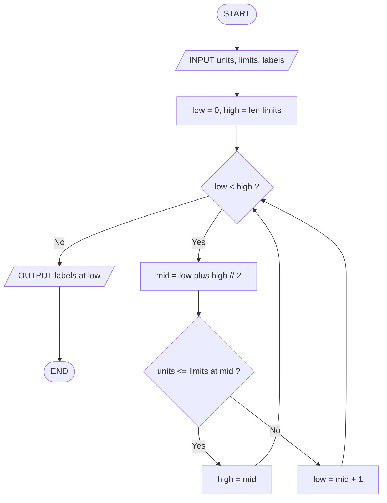

# Q7 – Diagnose, Redesign and Validate (K5, Day-4 Design Challenge)

**Run:** `python run_q7.py`  (code: `redesign.py`; the original rule is in `Q1/subsidy.py`)

**Program selected:** the Q1 slab decision (`if–elif–else` / linear search of slabs). Evidence from Q1: the time per decision grew from 69 ns (k = 3) to 905 ns (k = 100) to 11,196 ns (k = 1000) – **linear in the number of slabs k**. The subsidy tariff was 3 slabs; the changed requirement is a tariff with many slabs (for example 1,000 slabs and millions of households at billing time).
No built-in `bisect` is used: the search is written by hand.

## A. Diagnose the bottleneck (from my own evidence)
- **Where the work is:** in the comparisons `units <= limit`, one per slab examined; the decision itself (returning a label) is O(1).
- **Which count grows with input:** comparisons per decision grow with k: Q1 measured 69 → 120 → 905 → 11,196 ns for k = 3, 10, 100, 1000; counted here: average 1.9 / 6.6 / 52.7 / 502.3 / 5,014.8 comparisons for k = 3 / 10 / 100 / 1000 / 10000, worst case k − 1.
- **Repeated / unnecessary work?** Yes. The slab limits are **sorted**, but the loop ignores that: when `units <= limit[500]` is false, it still tests limits 1…499 one by one although they are all smaller and certainly also false. Every comparison that has already been decided by an earlier one is wasted work.

## B. Design objective (measurable)
For k = 1,000 slabs, reduce the **average comparisons per decision from ≈ 500 to ≤ 12** (about log₂ k + 2) and the **time per decision by at least 10×**, with **identical decisions** on every input including all slab boundaries, and with no meaningful loss at k = 3.

## C. Revised solution
**What changed:** replace the linear scan by a **binary search** over the sorted list of upper limits.
**Property exploited:** the limits are sorted ascending – so one comparison with the middle limit tells which half contains the answer, and the other half can be discarded.
**Extra memory:** none beyond the limits list that the table version already keeps (O(k)); O(1) additional variables (`low`, `high`, `mid`).
**Trade-offs:** the limits must stay sorted (checked when the tariff is loaded); the code is more subtle than a chain of `elif` (off-by-one risk – tested at all boundaries); for k ≈ 3 there is no gain; the rule (ration card, elder) inside a slab is still evaluated after the slab is found.
Pseudocode:
```
ALGORITHM FindSlab
START
INPUT units, limits (sorted ascending), labels
SET low TO 0
SET high TO number of limits
WHILE low < high
    SET mid TO (low + high) // 2
    IF units <= limits[mid] THEN
        SET high TO mid
    ELSE
        SET low TO mid + 1
    ENDIF
ENDWHILE
OUTPUT labels[low]
END
```


## D. Prediction before implementing
Comparisons per decision: linear ≈ k/2 on average, binary ≈ log₂ k. For k = 1000: ≈ 500 → ≈ 10 (about 50× fewer). Time should improve **less** than the count (the binary loop does more work per comparison), perhaps 10–30×; at k = 3 no real gain (1–2 comparisons either way).

## E. Implement and validate (same inputs for both; output of `run_q7.py`)
| k | linear avg comparisons | linear max | binary avg | binary max | log₂ k | same answers |
|---|---|---|---|---|---|---|
| 3 | 1.9 | 2 | 1.3 | 2 | 1.6 | yes |
| 10 | 6.6 | 9 | 3.3 | 4 | 3.3 | yes |
| 100 | 52.7 | 99 | 6.7 | 7 | 6.6 | yes |
| 1,000 | 502.3 | 999 | 10.0 | 10 | 10.0 | yes |
| 10,000 | 5,014.8 | 9,999 | 13.4 | 14 | 13.3 | yes |
Boundary validation (k = 1000): 3,000 inputs (every limit −1, limit, limit +1, 0, negative, 10⁹): **0 mismatches**; the original slabs 100/200 give slabs for 100, 101, 200, 201 = 0, 1, 1, 2 as in Q1.

| k | time per decision, original (ns) | redesign (ns) | speed-up |
|---|---|---|---|
| 3 | 173 | 120 | 1.4× |
| 10 | 262 | 194 | 1.3× |
| 100 | 1,126 | 343 | 3.3× |
| 1,000 | 12,968 | 659 | 19.7× |
| 10,000 | 204,494 | 1,730 | 118× |
(Times vary a little between runs; counts do not.)

## F. Defend the final design
- **Objective achieved?** Yes: at k = 1000 the average comparisons fell from 502 to 10.0 (≤ 12 ✔, 50× fewer) and the time per decision from ~13,000 to ~660 ns (19.7× ≥ 10× ✔); all 3,000 boundary inputs agree.
- **Size of improvement:** grows with k: 1.4× at k = 3 and 118× at k = 10,000. Time improves less than the comparison count (50× vs 20× at k = 1000) because each binary step does extra arithmetic.
- **New costs:** sorted limits must be guaranteed; more complex code to read and test (an off-by-one error would misclassify exactly the boundary households – the ones Q1 cared about); no memory saving.
- **Where the original is still better:** with the real 3-slab subsidy rule (or any k ≲ 10) the `if–elif` chain is clearer, easier to change and just as fast (≈ 1–2 comparisons either way, the 1.4× gap is a few dozen nanoseconds). Use the redesign only when the tariff has many slabs or millions of decisions are made.
- **Conclusion:** keep the readable `if–elif–else` for the three-slab subsidy; adopt the binary search when slab tables grow to dozens of slabs or more.
